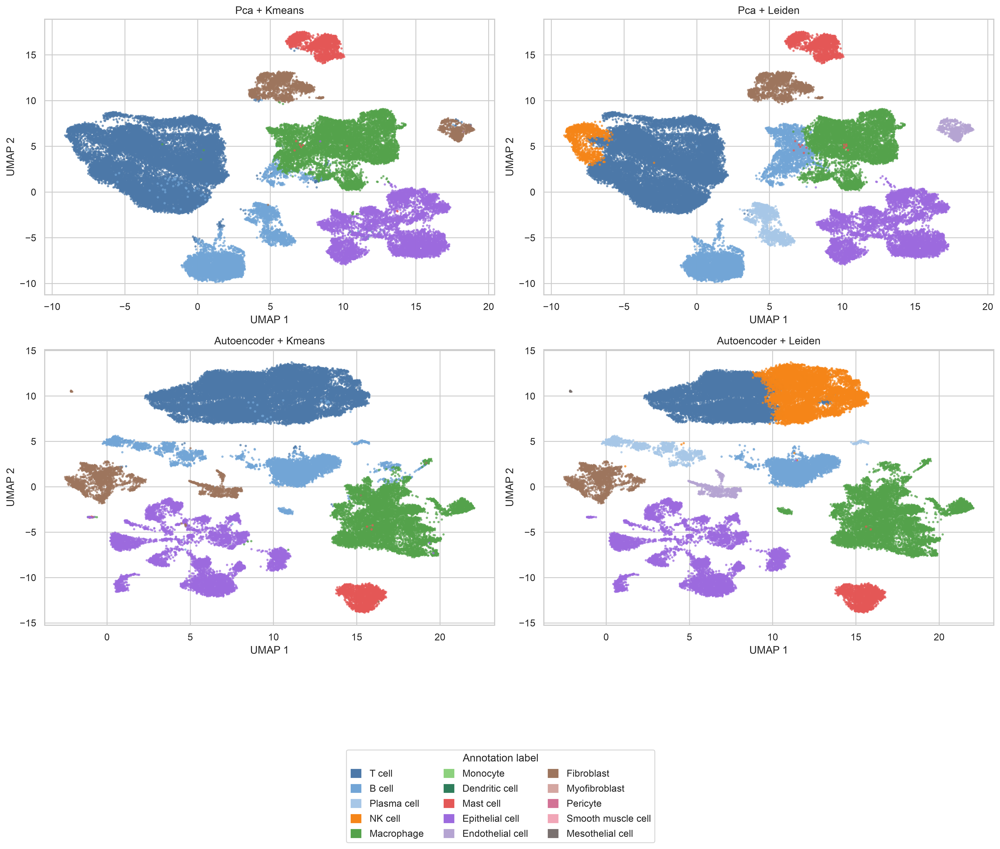

# Identifying Cell Types in Lung Tumors: A Machine Learning Approach

**Project team:** Zhen Lin, Xinyue Wang, Joshua Ren, and Mingji Xi

## Overview

Lung tumors contain malignant, immune, and stromal cell populations that can influence tumor progression. This project develops a machine learning workflow to identify cell populations in primary lung adenocarcinoma tumors from single-cell RNA sequencing data.

We compare two cell representations, principal component analysis (PCA) and a feed-forward autoencoder, with K-means and Leiden clustering. Clusters are annotated using a fixed lung and tumor-microenvironment marker panel, then compared with source-provided cell-type labels that are withheld from the unsupervised workflow.

## Data

The analysis uses [GEO GSE131907](https://www.ncbi.nlm.nih.gov/geo/query/acc.cgi?acc=GSE131907). It includes a raw UMI count matrix, cell annotations, and a feature summary. This dataset contains in total 45,149 cells from 11 primary lung tumor samples with expression measurements for 29,634 genes. After quality control, 44,180 cells are retained for representation learning and downstream analysis. Source-provided cell types are only used for the evaluation reported after cell-type annotation.

## Analysis workflow

The pipeline uses reproducible scripts and notebooks to generate and document the analysis results.

1. [Data exploration](notebooks/01_data-exploration.ipynb) summarizes sample sizes, cell-level metrics, and gene-level expression patterns.
2. [Quality control and preprocessing](notebooks/02_quality-control-and-preprocessing.ipynb) filters cells and genes, normalizes counts, and selects 2,000 highly variable genes.
3. [Dimension reduction and representation learning](notebooks/03_dimension-reduction-and-representation-learning.ipynb) fits 20-dimensional PCA and autoencoder representations, and compares UMAP and t-SNE visualizations.
4. [Clustering](notebooks/04_clustering.ipynb) evaluates K-means and Leiden clustering with hyperparameters optimized for both representations.
5. [Cell-type annotation and evaluation](notebooks/05_annotation-and-evaluation.ipynb) ranks cluster markers, assigns cell types based on a dataset of known markers, and evaluates the four representation-clustering combinations against the withheld labels.

Shared settings, including the selected samples, quality-control thresholds, random seed, and modeling parameters, are defined in [`configs/default.yml`](configs/default.yml).

## Current results

The table below summarizes external evaluation after marker-based annotation. PCA paired with Leiden clustering is the strongest current combination by macro-F1 and precision.

| Representation | Clustering | N clusters | N cell types | Precision | Accuracy | Macro-F1 |
| --- | --- | ---: | ---: | ---: | ---: | ---: |
| PCA | K-means | 6 | 6 | 0.695 | 0.943 | 0.713 |
| PCA | Leiden | 17 | 9 | 0.918 | 0.932 | 0.921 |
| Autoencoder | K-means | 8 | 6 | 0.696 | 0.950 | 0.716 |
| Autoencoder | Leiden | 14 | 10 | 0.885 | 0.830 | 0.866 |



*UMAP views of the annotations for the four representation-clustering combinations.*

Additional figures and machine-readable summaries are available in [`outputs/figures/`](outputs/figures/) and [`outputs/tables/`](outputs/tables/).

## Repository structure

```text
lung-tumor-cell-type-identification/
├── README.md                # Project overview, results, and reproduction guide
├── Makefile                 # Commands for the ordered analysis workflow
├── environment.yml          # Conda environment specification
├── configs/
│   ├── default.yml          # Shared data, preprocessing, and model settings
│   └── cell-type-markers.yml # Frozen marker panel and its provenance
├── data/
│   ├── raw/                 # Downloaded GEO source files, ignored by Git
│   └── processed/           # Generated analysis inputs, ignored by Git
├── scripts/                 # Download, conversion, fitting, and evaluation code
├── notebooks/               # Executable analysis notebooks in pipeline order
├── outputs/
│   ├── figures/             # Tracked figures
│   ├── tables/              # Tracked summary and evaluation tables
│   ├── embeddings/          # Saved PCA and autoencoder checkpoints
│   ├── clusters/            # Saved clustering assignments
│   ├── annotations/         # Saved annotation assignments
│   └── models/              # Saved autoencoder weights
├── documents/
│   ├── proposal/            # Project proposal
│   ├── report/              # Final report materials
│   └── implementation_notes/ # Local detailed notes, ignored by Git
├── references/              # Local background materials, ignored by Git
└── instructions/            # Local course materials, ignored by Git
```

## Environment and reproducibility

Create and activate the Conda environment from the project root:

```bash
conda env create -f environment.yml
conda activate lung-tumor-cell-type-identification
```

Use `make help` to view the available workflow commands. A complete rerun requires the following targets in order:

```bash
make download
make convert
make explore
make preprocess
make representation
make clustering
make annotation
```

The download and conversion stages retrieve and process the raw sparse count matrix. A complete rerun therefore requires internet access and substantially memory (32 GB or more).

To support collaboration when a full rerun is not practical, the repository tracks the following analysis checkpoints:

- PCA and autoencoder embeddings in `outputs/embeddings/`
- clustering assignments in `outputs/clusters/clustering-labels.csv.gz`
- cell-type annotation assignments in `outputs/annotations/annotation-labels.csv.gz`
- trained autoencoder weights in `outputs/models/autoencoder.pt`

These files support inspection of the saved representations and results without retraining.

## References

- [GEO GSE131907](https://www.ncbi.nlm.nih.gov/geo/query/acc.cgi?acc=GSE131907)
- [CellMarker 2.0](https://bio-bigdata.hrbmu.edu.cn/CellMarker2.0/), the source used to freeze the lung and tumor-microenvironment marker panel in [`configs/cell-type-markers.yml`](configs/cell-type-markers.yml)
